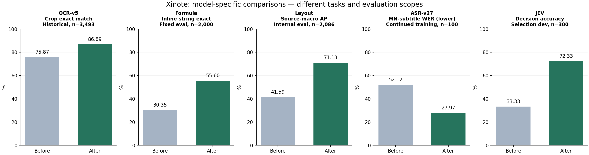

# Xinote Model Training & Benchmark Results

OCR · Formula Recognition · Document Layout · Streaming ASR · JEV Page Decisions

Xinote 백엔드 관련 모델의 **학습 목표, loss, 하이퍼파라미터와 학습 전후 평가 결과**를 모은 결과 전용 포트폴리오입니다. 확인 기준일은 **2026-11-12**입니다.

**학습 데이터·검증 원문·라벨·전사문·샘플 이미지·학습 코드·가중치는 공개하지 않습니다.** 이 저장소는 모델 설명, 집계 수치, 숫자로 생성한 그래프만 포함합니다. 데이터 출처별 이름은 일부 익명화했습니다.

## 한눈에 보기

| 모델 | 평가 / 비교 | 지표 | n | 초기·기준 | 학습·변경 후 | 변화 |
|---|---|---|---:|---:|---:|---:|
| OCR-v5 | 같은 크롭, 공식 초기 → 학습 후 | Exact match | 3,493 | 75.87% | 86.89% | +11.02 pp |
| Formula | Inline, 공식 초기 → r1 epoch 3 | LaTeX string exact | 2,000 | 30.35% | 55.60% | +25.25 pp |
| Layout | 7개 소스, 공식 초기 → 학습 후보 | Source-macro AP | 2,086 | 41.59% | 71.13% | +29.55 pp |
| ASR-v27 | 몽골어 자막 발화, v26m2 → v27 | WER ↓ | 100 | 52.12% | 27.97% | -24.15 pp |
| JEV | 같은 개발셋, imajev 초기 → 선택 checkpoint | Decision accuracy | 300 | 33.33% | 72.33% | +39.00 pp |

- OCR-v5: 같은 3,493개 크롭에서 비교한 과거 실험입니다. 현재 OCR 캐시 가중치와 이 체크포인트의 동일성은 확인되지 않아, 현 운영 정확도로 표시하지 않습니다.
- Formula: 공식 초기 가중치와 학습된 r1 epoch 3을 같은 평가셋에서 비교했습니다. 별도로 이전 운영 모델 대비 결과도 공개합니다. 학습 export와 현재 s1 모델의 SHA-256이 일치합니다.
- Layout: 대규모 학습 후보입니다. 2,086쪽의 같은 내부 평가셋을 사용했으며, 과거 실험에서 일부 평가 문서에 노출된 이력이 있습니다. 신규 완전 비노출 평가나 공식 리더보드 성능을 뜻하지 않습니다. 운영 모델은 교체하지 않았습니다.
- ASR-v27: 추가 학습 직전 v26m2와 v27을 비교합니다. 원본 사전학습 모델과의 비교가 아닙니다. 현재 설정이 가리키는 가중치와 v27 학습 export의 SHA-256이 일치합니다.
- JEV: 초기 imajev 어댑터와 도메인 학습 어댑터의 **300개 개발셋** 비교입니다. 해당 개발셋으로 체크포인트를 선택했으므로 독립 테스트 성능으로 해석하지 않습니다.

서로 다른 지표와 표본을 하나의 종합 점수로 합치지 않습니다. 정확도·AP·F1은 높을수록, CER·WER·loss는 낮을수록 좋습니다. `%` 차이는 **퍼센트포인트(pp)**로 표기합니다.

## 모델별 문서

| 모델군 | 포함 내용 | 현재 상태 |
|---|---|---|
| [OCR](docs/ocr.md) | v5 det/rec, v6 도메인 적응, 세대 교체 비교, loss와 설정 | 과거 실험 + 별도 후보 |
| [Formula](docs/formula.md) | 공식 초기 모델 / 이전 운영 / r1e3, 문자열·렌더 지표 | 배포 가중치 일치 |
| [Layout](docs/layout.md) | 대규모 RT-DETR 학습, 7개 영역별 결과와 분할 한계 | 후보, 운영 변경 없음 |
| [ASR](docs/asr.md) | v27 추가 학습, 0.6B 초기 모델 비교와 회귀 항목 | v27 가중치 일치 + 과거 실험 |
| [JEV](docs/jev.md) | 후보 선택 CE, LoRA 설정, 초기·선정·마지막 개발셋 곡선 | 실험, 독립 테스트 미확보 |

## 숫자와 근거

- [비교표 CSV](metrics/comparisons.csv) / [JSON](metrics/comparisons.json): 원래 정밀도를 보존한 기준값, 변경 후 값, 절대 변화와 상대 개선율.
- [Loss·하이퍼파라미터 요약](metrics/training-summary.json).
- [JEV 개발셋 기록](metrics/jev-validation-curve.json).
- [비공개 근거 파일의 지문](evidence/provenance.json): 원문 대신 source ID와 SHA-256만 포함합니다.
- [모델 가중치 식별 결과](evidence/model-identities.json): 선택된 파일과 학습 export의 일치 여부.
- [평가 원칙과 공개 범위](docs/methodology.md).

이 작업은 기존 학습·평가 산출물의 감사 및 집계입니다. 새 모델 학습이나 GPU 벤치마크를 수행하지 않았고, 운영 프로세스·모델도 변경하지 않았습니다. 실제 입력과 학습 코드를 공개하지 않으므로 제3자의 완전 재현을 보장하지 않습니다.
