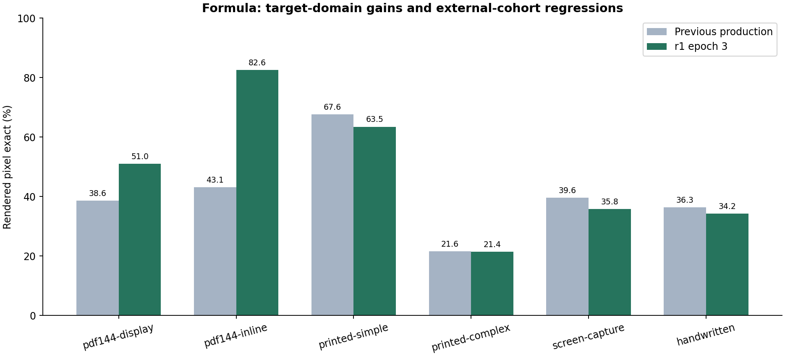

# Formula recognition: PP-FormulaNet_plus-S

## 초기 모델 → r1 epoch 3

공식 plus-S 사전학습 가중치에서 학습한 checkpoint입니다. 아래는 동일 평가셋의 **LaTeX 문자열 exact match**입니다.

| 평가 / 비교 | 지표 | n / 유효 n | 초기·기준 | 학습·변경 후 | 변화 |
|---|---|---:|---:|---:|---:|
| pdf144-display · official-pretrained-to-r1e3 | LaTeX-string-exact | 3,000 / 3,000 | 19.87% | 31.37% | +11.50 pp |
| pdf144-inline · official-pretrained-to-r1e3 | LaTeX-string-exact | 2,000 / 2,000 | 30.35% | 55.60% | +25.25 pp |
| printed-simple · official-pretrained-to-r1e3 | LaTeX-string-exact | 6,762 / 6,762 | 27.40% | 41.94% | +14.54 pp |
| printed-complex · official-pretrained-to-r1e3 | LaTeX-string-exact | 5,921 / 5,921 | 4.48% | 11.97% | +7.50 pp |
| screen-capture · official-pretrained-to-r1e3 | LaTeX-string-exact | 4,742 / 4,742 | 33.51% | 29.35% | -4.15 pp |
| handwritten · official-pretrained-to-r1e3 | LaTeX-string-exact | 6,332 / 6,332 | 32.64% | 33.95% | +1.31 pp |

Screen-capture 부분집합에서는 33.51% → 29.35%로 하락했습니다. 모든 종류의 수식에서 개선됐다고 주장하지 않습니다.

## 이전 운영 모델 → r1 epoch 3

| 평가 / 비교 | 지표 | n / 유효 n | 초기·기준 | 학습·변경 후 | 변화 |
|---|---|---:|---:|---:|---:|
| pdf144-display · previous-production-to-r1e3 | rendered-pixel-exact | 3,000 / 3,000 | 38.63% | 50.97% | +12.33 pp |
| pdf144-inline · previous-production-to-r1e3 | rendered-pixel-exact | 2,000 / 2,000 | 43.10% | 82.60% | +39.50 pp |
| printed-simple · previous-production-to-r1e3 | rendered-pixel-exact | 6,762 / 6,761 | 67.62% | 63.47% | -4.16 pp |
| printed-complex · previous-production-to-r1e3 | rendered-pixel-exact | 5,921 / 5,880 | 21.62% | 21.43% | -0.19 pp |
| screen-capture · previous-production-to-r1e3 | rendered-pixel-exact | 4,742 / 4,729 | 39.61% | 35.80% | -3.81 pp |
| handwritten · previous-production-to-r1e3 | rendered-pixel-exact | 6,332 / 6,316 | 36.29% | 34.21% | -2.07 pp |

문자열 exact는 표현식의 문자열 동일성, rendered pixel exact는 같은 렌더 환경의 픽셀 동일성입니다. 수학적 의미의 동치 판정이 아닙니다. 일부 참조가 렌더되지 않아 픽셀 지표의 유효 n이 전체 n보다 작습니다. 예: printed-complex **5,921개 중 5,880개**, screen-capture **4,742개 중 4,729개**입니다. 문자열 지표는 전체 n을 사용합니다.

이전 운영 모델 대비 PDF144 display는 **38.63% → 50.97%**, inline은 **43.10% → 82.60%**입니다. 반면 외부 양식 4개 부분집합의 픽셀 exact는 모두 하락했습니다. 전체 raw precision은 CSV/JSON에 보존합니다.

## Loss와 하이퍼파라미터

| 항목 | 값 |
|---|---|
| Initializer | official PP-FormulaNet_plus-S pretrained |
| Loss | PPFormulaNet_S_Loss; mean token cross-entropy; ignore_index=-100; parallel_step=3 |
| Optimizer | AdamW; betas 0.9/0.999; weight decay 0.05 |
| LR | 5e-5; LinearWarmupCosine; warmup 1,000 steps; start 1e-6; minimum 1e-7 |
| Batch | 24 / GPU |
| Epochs | 3; selected export epoch 3 |
| Precision | AMP O1; initial loss scale 1,024 |
| Evaluation | batch 32; same fixed cohorts for each comparison |
| Training material | private original and PDF-rendered formula examples; raw data/labels withheld |

## 모델 식별

Selected export SHA-256: `3f07f6aa1bfce9012b32de6e9eba40f3a0ebd3adedb165244378e63ab9a3d305`.

이 지문이 현재 s1의 선택된 Formula 파일과 일치합니다. 폴더의 오래된 `epoch1` 이름으로 버전을 판단하지 않았습니다. 과거 88.07% 모델 카드의 파일은 백업에 남아 있으며, 위 체크포인트와 평가셋의 결과로 재사용하지 않습니다.

근거: `FORMULA-r1-config`, `formula_official`, `formula_official_target`, `formula_previous`, `formula_after`, `FORMULA-pixel-aggregate`.
