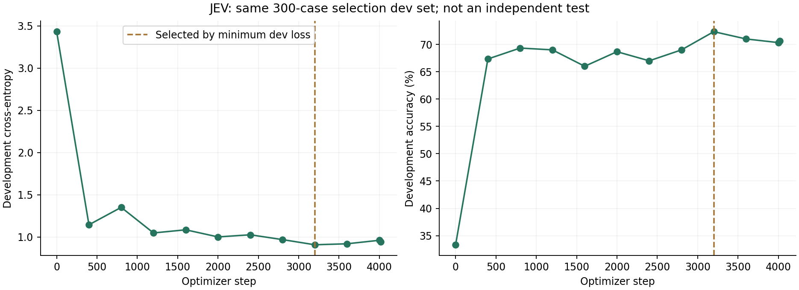

# JEV: imajev-based page decisions

Qwen3.5-4B 기반 imajev-4b 어댑터를 시작점으로, 문서 페이지 후보를 선택하도록 도메인 학습한 v3 실험입니다. 범용 라우터 사용 기록과 구분했습니다.

## 초기 · 선택된 checkpoint · 마지막 checkpoint

| 구분 | step | Development accuracy | Development CE loss |
|---|---:|---:|---:|
| 초기 imajev adapter | 0 | 33.33% | 3.431520 |
| 최소 dev loss로 선택 | 3,200 | 72.33% | 0.909044 |
| 마지막 | 4,018 | 70.67% | 0.946289 |

같은 300개 개발 예제에서 선택 checkpoint의 정확도는 **+39.00pp**, CE는 **3.431520 → 0.909044**입니다. 마지막 step을 최고 성능인 것처럼 바꾸어 표시하지 않았습니다.

## Loss와 하이퍼파라미터

| 항목 | 값 |
|---|---|
| Starting model | Qwen3.5-4B + imajev-4b adapter |
| Objective | candidate-label cross-entropy at served decision position; candidate logits cast to FP32; no label smoothing |
| Readout | 256 decision codes |
| Optimizer | AdamW; weight decay 0 |
| LR / warmup | 5e-5 / 100 steps |
| LoRA | rank 64; alpha 128 |
| Targets | q/k/v/o projections, gate/up/down projections, in_proj_qkv, in_proj_z, out_proj |
| Batch | 1 × accumulation 8 × world size 1 = 8 |
| Gradient clip | 1.0 |
| Context | maximum 4,096 tokens; examples over limit rejected rather than silently truncated |
| Budget | 1 epoch; 32,137 train cases; 4,018 optimizer steps observed |
| Validation | 300 cases; every 400 steps; choose minimum dev loss |
| Seed | 0 |

**개발셋은 모델 선택에 재사용됩니다.** 독립적인 최종 test, 서비스 전체 페이지 매핑 정확도 또는 앞선 비학습 MaViLS 비교의 수치가 아닙니다. 이전 14-lecture 비교, vLLM latency 최적화, 현재 live demo의 설정을 이 학습의 정확도 개선으로 합치지 않았습니다. 데이터 내용·대상 문서·정답 후보와 학습 코드는 공개하지 않습니다.

근거: `JEV-v3-config`, `JEV-v3-log`.
