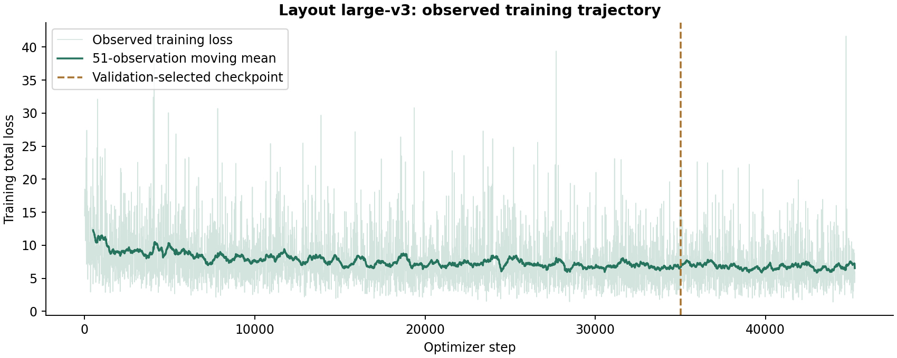

# Document layout: PP-DocLayout_plus-L large-v3

## 고정 내부 평가 결과

| 평가 / 비교 | 지표 | n / 유효 n | 초기·기준 | 학습·변경 후 | 변화 |
|---|---|---:|---:|---:|---:|
| all-domains · official-pretrained-to-large-v3 | source-macro-AP | 2,086 / 2,086 | 41.59% | 71.13% | +29.55 pp |
| all-domains · official-pretrained-to-large-v3 | source-macro-region-F1 | 2,086 / 2,086 | 78.08% | 88.55% | +10.47 pp |
| document-figures · official-pretrained-to-large-v3 | canonical-AP | 213 / 213 | 47.98% | 76.93% | +28.95 pp |
| posters · official-pretrained-to-large-v3 | canonical-AP | 68 / 68 | 56.37% | 83.04% | +26.67 pp |
| general-documents · official-pretrained-to-large-v3 | canonical-AP | 1,004 / 1,004 | 39.27% | 78.32% | +39.05 pp |
| presentations · official-pretrained-to-large-v3 | canonical-AP | 166 / 166 | 54.79% | 71.59% | +16.80 pp |
| reports · official-pretrained-to-large-v3 | canonical-AP | 80 / 80 | 40.92% | 71.58% | +30.66 pp |
| scans-text-only · official-pretrained-to-large-v3 | canonical-AP | 80 / 80 | 10.05% | 56.35% | +46.30 pp |
| slides · official-pretrained-to-large-v3 | canonical-AP | 475 / 475 | 41.73% | 60.13% | +18.40 pp |

Source-macro AP는 7개 소스의 AP@[.50:.95]를 같은 비중으로 평균한 값입니다. 전체 페이지를 합쳐 계산한 단일 COCO AP나 공식 벤치마크 리더보드 점수와 다릅니다. Region F1도 별도의 metric이며 AP와 혼합하지 않습니다.

## Loss와 학습 설정

| 항목 | 값 |
|---|---|
| Initializer | official PP-DocLayout_plus-L; 819 training tensors loaded |
| Architecture | PPHGNetV2-L + RT-DETR; 20 classes; 300 queries |
| Objective | ConsistencyDINOLoss: VariFocal classification + L1 + GIoU + decoder auxiliary / denoising losses |
| Loss coefficients | class : bbox : GIoU = 1 : 5 : 2 |
| Hungarian matching coefficients | class : bbox : GIoU = 2 : 5 : 2 |
| Optimizer | AdamW; weight decay 1e-4; global norm clip 1.0 |
| LR | 2e-5 peak; linear warmup 500 steps; elapsed-training-time cosine to 10% |
| Batch | 4 / GPU × 4 GPUs = 16 |
| Resize | random 768 / 800 / 864 during training |
| Training split | 113,921 pages / 8,323 documents |
| Validation / internal test | 2,058 / 2,086 pages |
| Budget | 21,600 active training seconds; completed at step 45,242 |
| Selection | validation-selected step 35,000 |
| Augmentation | document appearance noise probability 0.4 |

### 불완전 라벨 처리

미주석 클래스와 검증할 수 없는 영역은 negative classification 및 평가에서 제외합니다. 스캔 부분집합의 지도는 **text paragraph에 한정**되므로 표·그림 탐지 성능을 검증한 것으로 해석하지 않습니다.

## 평가의 한계와 운영 상태

- 이번 split 간 문서 중복 및 정확한 픽셀 중복은 모두 0으로 기록됐습니다.
- 다만 일부 평가 문서는 이전 실험에서 사용된 이력이 있습니다. 엄격한 신규 비노출 테스트는 아닙니다.
- 전체 학습 라벨이 사람에 의해 전수 검수된 것은 아닙니다.
- `active_model_changed=false`: **학습 후보 결과**이며, 현재 서빙 중인 과거 v2 가중치의 성능으로 표시하지 않습니다.
- 예전 소규모 공개 보고서의 baseline 0.745와 보존된 원시 baseline 0.696이 일치하지 않아, 그 과거 개선율은 이번 요약에 재사용하지 않았습니다.

근거: `LAYOUT-v3-comparison`, `LAYOUT-v3-training-log`.
